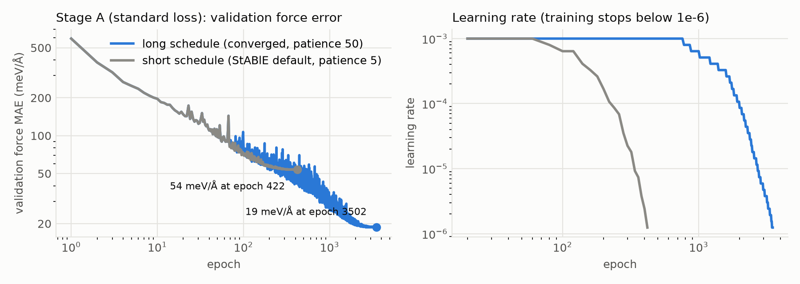
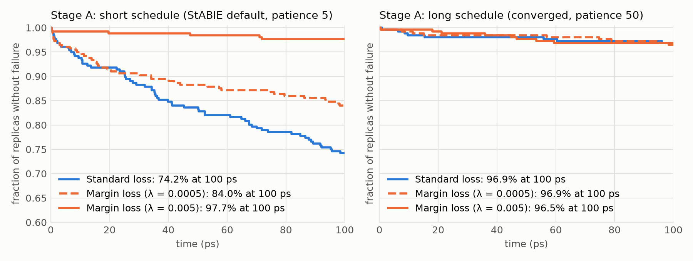
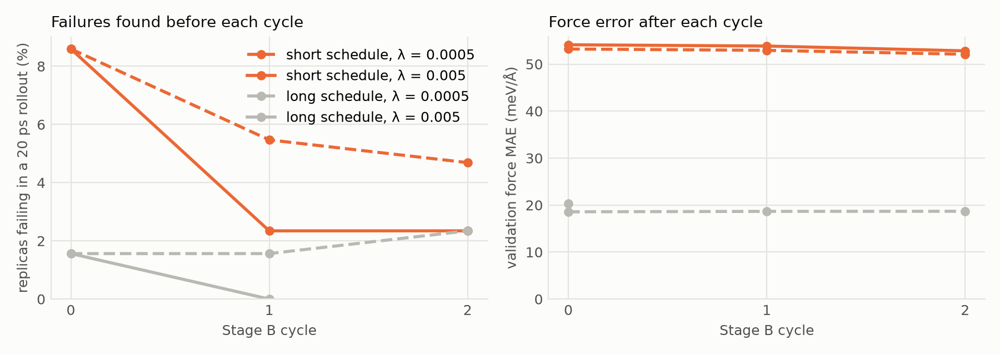
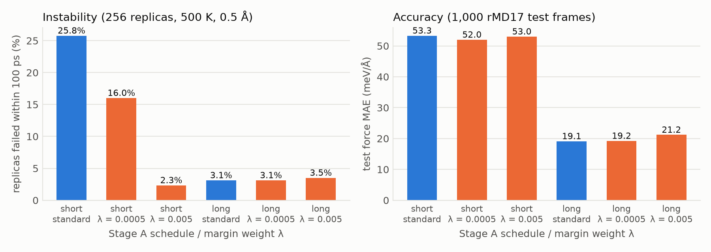

# Milestone results: SchNet on ethanol

Generated by `python scripts/analysis/milestone.py plot` from `docs/milestone/data/`. Notes on setup, caveats and the Stage B settings sweep are in [README.md](README.md).

| Stage A schedule | Loss | Force MAE (meV/Å) | Energy MAE (meV) | Stable at 100 ps | Failed / 256 | Mean τ (ps, capped at 100) | h(r) MAE | Dihedral F MAE (kcal/mol) | NVE drift (meV/atom/ps) |
|---|---|---|---|---|---|---|---|---|---|
| short schedule (StABlE default, patience 5) | Standard loss | 53.3 | n/a¹ | 74.2% | 66 | 84.4 | 0.104 | 0.54 | 0.046 |
| short schedule (StABlE default, patience 5) | Margin loss (λ = 0.0005) | 52.0 | 19.7 | 84.0% | 41 | 89.1 | 0.106 | 0.51 | 0.052 |
| short schedule (StABlE default, patience 5) | Margin loss (λ = 0.005) | 53.0 | 20.1 | 97.7% | 6 | 98.5 | 0.105 | 0.54 | 0.040 |
| long schedule (converged, patience 50) | Standard loss | 19.1 | n/a¹ | 96.9% | 8 | 97.9 | 0.112 | 0.56 | 0.082 |
| long schedule (converged, patience 50) | Margin loss (λ = 0.0005) | 19.2 | 4.0 | 96.9% | 8 | 98.3 | 0.112 | 0.54 | 0.079 |
| long schedule (converged, patience 50) | Margin loss (λ = 0.005) | 21.2 | 6.1 | 96.5% | 9 | 98.0 | 0.111 | 0.53 | 0.095 |

¹ Evaluated before the energy-offset fix in `mdsim_backend.py`; the energy MAE of these two runs is not meaningful. Force MAE and stability are unaffected.

